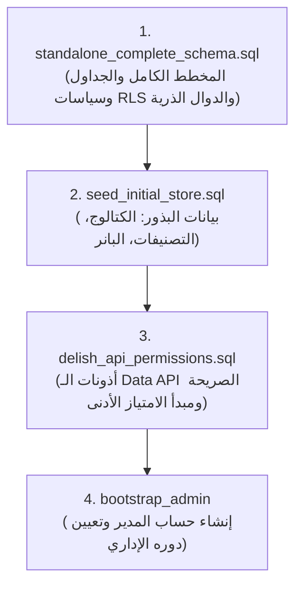

# Delish Cake & Bake — Deployment Runbook & Operating Guide
# دليل تشغيل ونشر مشروع مخبز وحلويات ديليش

هذا الدليل يوضح الخطوات المعتمدة لتأسيس وتشغيل مشروع ديليش كيك محلياً وعلى بيئات الإنتاج السحابية، وترتيب تشغيل ملفات قاعدة البيانات (PostgreSQL / Supabase).

---

## 1. خطوات تأسيس قاعدة البيانات على Supabase (Database Setup Order)

يجب تنفيذ ملفات SQL الثلاثة في **SQL Editor** داخل لوحة تحكم Supabase بالترتيب الصارم التالي:



### الخطوة 1: المخطط الشامل والسياسات والدوال الذرية
- **الملف:** [`supabase/standalone_complete_schema.sql`](./supabase/standalone_complete_schema.sql)
- **الوظيفة:** ينشئ جميع الجداول (الطلبات، الأصناف، الدفعات، رموز التعديل، سجل التدقيق)، والأنواع (`app_role`, `order_status`)، وفهارس الأداء، ودوال التحقق، وسياسات الحماية على مستوى الصفوف (RLS)، ودوال العمليات الذرية المتزامنة (`create_storefront_order_atomic`, `update_order_item_atomic`, إلخ).

### الخطوة 2: بيانات المتجر الأولية والكتالوج الافتراضي
- **الملف:** [`supabase/seed_initial_store.sql`](./supabase/seed_initial_store.sql)
- **الوظيفة:** يملأ قاعدة البيانات ببانر المتجر الافتراضي، والتصنيفات الخمسة الأساسية، والأصناف الستة الأكثر مبيعاً مع الصور والأحجام والأسعار بالدينار الأردني (JOD).

### الخطوة 3: أذونات الـ Data API الصريحة ومبدأ الامتياز الأدنى (Least Privilege)
- **الملف:** [`supabase/delish_api_permissions.sql`](./supabase/delish_api_permissions.sql)
- **الوظيفة:** **يُنفّذ فوراً بعد ملف المخطط وملف البذور**. يضبط صلاحيات `GRANT` و `REVOKE` الدقيقة على مستوى PostgREST API:
  - يمنح الزوار غير المسجلين (`anon`) صلاحية قراءة الكتالوج والبانر والتصنيفات فقط (`SELECT` على `products`, `storefront_categories`, `storefront_banner`, `store_settings`).
  - يعزل تماماً جداول الطلبات والدفعات وسجلات التدقيق والأدوار عن الزوار (`401 / 42501 permission denied`).
  - يقصر عمليات التعديل والإنشاء الحساسة على الدوال الذرية الموثوقة أو مفتاح الخادم السري (`service_role`).

---

## 2. إنشاء وتفعيل حساب المدير الأول (Admin Bootstrap)

1. من لوحة Supabase، انتقل إلى **Authentication -> Users** واضغط **Add User -> Create user**.
2. أدخل البريد: `admin@delish.local` وكلمة مرور قوية.
3. انسخ معرف المستخدم (UID) المولد.
4. نفّذ الاستعلام التالي في **SQL Editor** لربط الحساب بدور المدير ورمز الموظف 1:
```sql
INSERT INTO public.user_roles (user_id, role)
VALUES ('PASTE_USER_UUID_HERE'::uuid, 'admin'::public.app_role)
ON CONFLICT (user_id, role) DO NOTHING;

INSERT INTO public.staff_codes (user_id, staff_code)
VALUES ('PASTE_USER_UUID_HERE'::uuid, 1)
ON CONFLICT (user_id) DO NOTHING;

INSERT INTO public.app_setup_state (id, admin_setup_completed_at)
VALUES (true, now())
ON CONFLICT (id) DO UPDATE SET admin_setup_completed_at = now();
```

---

## 3. إعداد البيئة المحلية (`.env`)

انسخ محتوى `.env.example` إلى ملف `.env` واضبط القيم:
```env
SUPABASE_URL="https://your-project-id.supabase.co"
VITE_SUPABASE_URL="https://your-project-id.supabase.co"
SUPABASE_PROJECT_ID="your-project-id"
VITE_SUPABASE_PROJECT_ID="your-project-id"
SUPABASE_PUBLISHABLE_KEY="sb_publishable_..."
VITE_SUPABASE_PUBLISHABLE_KEY="sb_publishable_..."
PUBLIC_SITE_URL="http://localhost:3000"
VITE_SITE_URL="http://localhost:3000"
SUPABASE_SERVICE_ROLE_KEY="sb_secret_..."
```
> [!IMPORTANT]
> تأكد دائماً أن ملف `.env` مستثنى من Git في `.gitignore`، ولا ترفع المفتاح السري `SUPABASE_SERVICE_ROLE_KEY` إطلاقاً.

---

## 4. التشغيل والبناء (Build & Run Commands)

### التشغيل المحلي للتطوير:
```cmd
npm.cmd ci
npm.cmd run dev -- --port 3000 --strictPort
```

### فحص سلامة الأنواع والاختبارات:
```cmd
npx tsc --noEmit
npm test
```

### البناء للإنتاج:
- **نظام الحاويات / خوادم Node.js المستقلة (Docker / VPS):**
  ```cmd
  npm run build:node
  node .output/server/index.mjs
  ```
- **نظام الحوسبة السحابية الحافة (Cloudflare Pages / Workers):**
  ```cmd
  npm run build
  ```
